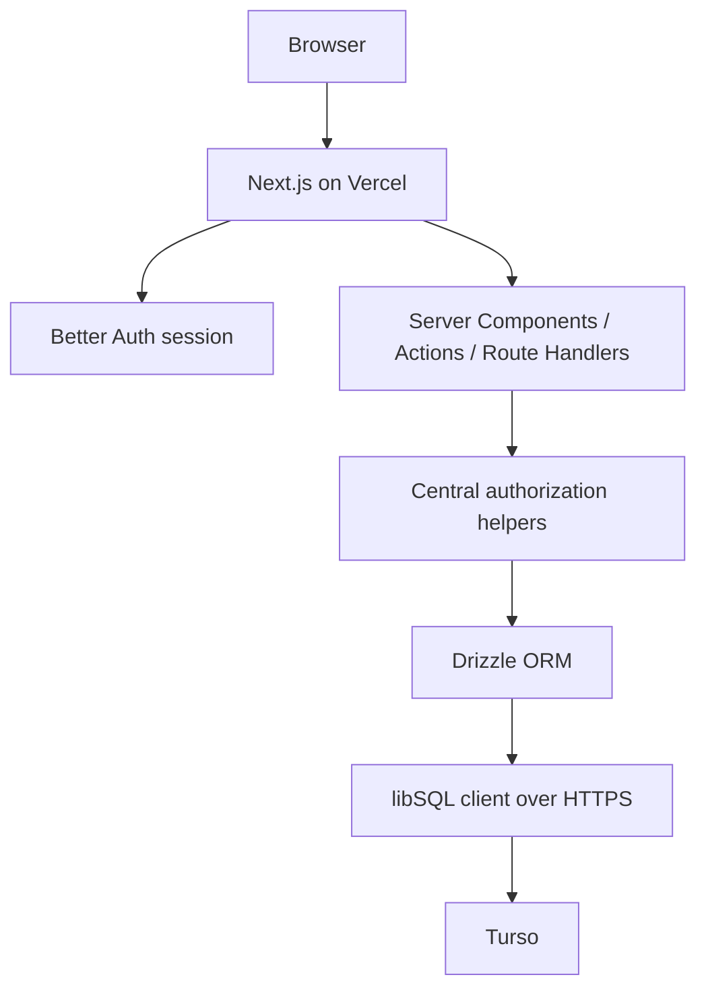

# Technical Architecture

## Canonical stack

- **Next.js** — full-stack web application
- **TypeScript** — strict mode
- **Tailwind CSS** and **shadcn/ui**
- **Better Auth** — private email/password authentication
- **Drizzle ORM** — SQLite schema dialect
- **Turso/libSQL** — remote SQLite-compatible database
- **`@libsql/client`** — server-side database driver
- **Zod**, **React Hook Form**, and **Playwright**
- **Vercel** — production hosting and Git-based deployments

Keep the stable package versions pinned by the repository. Do not upgrade to RC/latest releases solely to match an example.

## Runtime model



Browser code never receives a database connection or Turso credentials. Application routes use asynchronous database operations.

## Security boundary

All sensitive reads and mutations go through server-side application code that:

1. resolves the current Better Auth session;
2. verifies workspace membership;
3. applies ownership and purchase-state rules;
4. validates input using Zod;
5. executes Drizzle queries against Turso.

No RLS is required because the database is not exposed as a browser data API.

## Central authorization helpers

Implement and reuse helpers conceptually equivalent to:

- `requireUser()`
- `requireWorkspaceMember()`
- `requireFavoriteOwner()`
- `requireCollectionOwner()`
- `requireActivePurchase()`
- `requireEditablePurchase()`

Do not duplicate authorization conditionals across random UI/actions.

## Better Auth

- email + password only in MVP;
- public signup UI and endpoint are disabled;
- sessions use the same Turso database;
- operator tooling creates users;
- production passwords/emails are human input, never hardcoded;
- the Drizzle adapter remains configured with `provider: "sqlite"`.
- profile edits reuse Better Auth's `/update-user` and `/change-password` endpoints, with path-scoped server hooks that validate trusted origin, authoritative session, workspace membership and strict payloads;
- password hooks enforce 12–128 characters, reject immediate reuse and force `revokeOtherSessions: true`; Better Auth owns verification, hashing, persistence and cookie rotation.

`BETTER_AUTH_URL` must equal the deployed HTTPS origin. Keep `BETTER_AUTH_SECRET` server-only. Vercel preview environments should use the development database and matching preview URL configuration where sign-in is needed.

## Database runtime

The application creates one reusable libSQL client and Drizzle instance per server process. Runtime credentials are `TURSO_DATABASE_URL` and `TURSO_AUTH_TOKEN`; neither receives a `NEXT_PUBLIC_` prefix. Production has no dependency on a writable filesystem or `better-sqlite3`.

Local development and isolated tests can use `@libsql/client` with a local file URL or in-memory database. The schema, constraints, IDs, integer-cent money, category keys and purchase snapshots stay SQLite-compatible.

## Migrations

`src/lib/db/schema.ts` remains the source of truth. Keep the versioned migrations in `drizzle/` and use the libSQL migrator. Apply migrations explicitly with `npm run db:migrate` against the selected database before deployment. Do not put migrations in a route handler, middleware, server component, or request startup path.

## Project organization

```text
src/
  app/
    (auth)/login/
    (app)/favorites/
    (app)/purchase/
    (app)/history/
    (app)/packages/
    (app)/profile/
  components/
    ui/
    layout/
    favorites/
    purchase/
    product-category-icons/
  features/
    favorites/
    collections/
    purchases/
  lib/
    auth/
    db/
    money/
    urls/
    validation/
    domain/categories.ts

scripts/
  create-user.ts
  seed.ts
  import-legacy-spreadsheet.ts

public/
  login-stories/
```

Adapt if Next.js conventions or generated Better Auth files require slight differences, but preserve separation of concerns. Operational item markers render inline SVG via `ProductCategoryMarker`; `resolveProductCategory()` derives category keys stored in existing `visual_key` fields. No product render assets or image API. Editorial login assets remain independent. See `07_PRODUCT_VISUALS.md`.

## Domain mutations

Prefer small domain-oriented actions/functions:

### favorites

- createFavorite
- updateFavorite
- deleteFavorite

### collections

- createCollection
- renameCollection
- deleteCollection

### purchases

- createPurchase
- updatePurchaseMetadata
- finalizePurchase

### purchase items

- addFavoriteToPurchase
- addManualPurchaseItem
- updatePurchaseItem
- removePurchaseItem
- togglePurchaseItemCartStatus

### package costs

- initializePurchaseCosts atomically with purchase finalization;
- startCostTracking idempotently for a prior finalized purchase;
- read and mutate cost follow-ups only after session/workspace authorization and revision checks;
- keep money calculations pure and integer-cent based; validate package/item/user relationships inside the transaction.

The complete entity, state, concurrency and endpoint contract is in [the Packages and costs plan](21_PACKAGES_AND_COSTS_PLAN.md). This extension does not alter the finalized purchase, favorites or cost-sharing snapshots and does not add a payment processor or tracking integration.

## Validation and money

Validate at the server boundary even if the client already validates. Use integer cents for money and centralize parsing/formatting helpers for BRL display.

## URL handling and search

Centralize `detectPlatform(url)`, `normalizeProductUrl(url)` and/or `buildCanonicalProductKey(url)`. Preserve original URLs. For MVP scale, SQLite-compatible case-insensitive matching is sufficient; do not add a separate search service.

## Realtime and scaling

Realtime is not part of the MVP. After mutations, revalidate/refetch appropriate data. Vercel can run multiple stateless application instances because persistent state lives in Turso; do not add local-file coordination or application volumes.

## Invitation boundary

`src/lib/domain/invitations.ts` centralizes issuance, inspection, acceptance, regeneration and revocation. `/api/group` requires session/membership; `/api/invitations/[token]` permits token-validated public inspection/acceptance. Mutations check configured auth origin. Public signup stays disabled. Account creation uses a server-only operator-configured Better Auth instance bound to the Drizzle transaction with auto sign-in disabled. The transaction includes account/credential, membership, active workspace selection and invitation consumption. After commit, the browser establishes its session through the normal Better Auth login endpoint.

Tokens contain 32 random bytes; only SHA-256 hashes persist. No token/body logging is added by application code. Responses use no-store; the invitation page uses no-referrer and noindex. Infrastructure access-log retention/redaction must account for token-bearing paths. Persistent fixed-window minute limits are shared across instances: 15 management mutations per user, 240 public inspections globally, 60 accepts globally, 10 attempts per valid token. Limiter entries older than one hour are removed during requests.

Product refunds use additive Drizzle tables and the existing package-cost authorization, revision and transaction boundary. Persist request/receipt/void state and append-only event snapshots; calculate aggregate component credits using captured original participant shares. Apply the migration explicitly; requests never contact an external payment system. See [23 — product refunds](23_PRODUCT_REFUNDS_PLAN.md).

HubBuy QC is a separate server-only domain. Every endpoint resolves the Better Auth session and purchase membership; manager actions also compare the session user ID against server-only `LOTI_QC_MANAGER_USER_ID`. Strict bounded parsing, matching, manifests, persistent limits, image catalog, tombstones and audit events use Turso/Drizzle. A Node-only download service resolves and classifies all DNS answers, then connects to one validated public IP while retaining TLS hostname verification; a real image decoder validates bytes before any object upload. An injectable storage interface has mocked tests and a private Cloudflare R2 S3 implementation with separate read/write credentials; the browser receives only authorized IDs and short-lived presigned GETs. The feature never participates in package/refund transactions or snapshot writes. Migrations remain explicit. See [24 — HubBuy QC import](24_HUBBUY_QC_IMPORT_PLAN.md).

The approved post-MVP HubBuy financial extension is implemented server-side in the package/tracking domain and a dedicated CNY account ledger. It uses integer minor units, captured conversion pairs, idempotent operations, immutable ledger entries, individual credit shares, FIFO consumption links, and explicit member-financing entries. Additional order snapshots remain attached to their existing tracking; they do not create a new `Purchase`. Every mutation requires membership and revalidates tracking/account revisions in one database transaction. The feature is documented in [26 — HubBuy balance and mixed payments](26_HUBBUY_BALANCE_AND_MIXED_PAYMENTS_PLAN.md); the existing explicit migration and deployment boundaries still apply.
