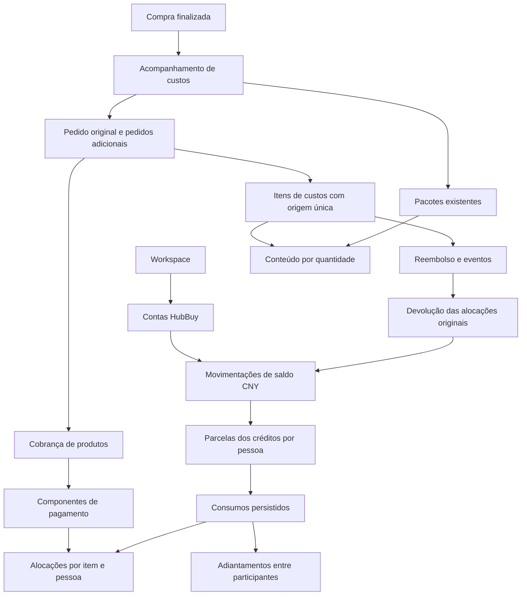

# Investigação — saldo HubBuy, reembolsos, pagamentos mistos e pedidos adicionais

Data: 17/10/2026. Natureza: investigação e proposta, **sem implementação**.

Base: checkout `3a0c5d4149dbaec801b4c656de11a20f01624844`, incluindo as alterações locais existentes em `next-env.d.ts`, `globals.css`, `package-cost-detail-screen.tsx` e `refunds-section.tsx`. Essas alterações foram preservadas. A análise não consultou banco real, conta HubBuy, extrato bancário nem dados de produção. Memórias, meias e Elixir são o contexto informado pelo usuário; os números adicionais deste relatório são exemplos sintéticos.

A recomendação é evoluir Pacotes e custos com **saldo CNY por conta HubBuy, créditos com participação econômica, consumo rastreável e pagamentos com componentes**, mantendo a compra finalizada intacta. Novos pedidos entram como registros adicionais do acompanhamento, com cobrança própria, e podem utilizar o pacote existente. O saldo não é desconto; é um ativo já financiado.

As propostas abaixo ampliam deliberadamente os planos 21/23, que hoje excluem câmbio, saldo reutilizável e pagamentos múltiplos. Este documento não altera esses contratos nem autoriza executar a proposta.

## 1. Como o Loti funciona hoje

### 1.1 Mapa verificável do código

As âncoras são do checkout analisado; os símbolos continuam sendo a referência se as linhas mudarem.

| Referência | Responsabilidade constatada |
| --- | --- |
| [Schema: compras e participantes](C:/Fontes/loti/src/lib/db/schema.ts:35) | `purchases`, `purchase_items`, `purchase_item_participants`; uma compra ativa por workspace, snapshots e rateio |
| [Schema: custos e pacotes](C:/Fontes/loti/src/lib/db/schema.ts:77) | Configuração de taxas, acompanhamento, custos, participantes, pacotes, alocações, cobranças e reaberturas |
| [Schema: reembolsos](C:/Fontes/loti/src/lib/db/schema.ts:203) | Reembolso corrente, participantes capturados e eventos ordenados |
| [Schema: QC](C:/Fontes/loti/src/lib/db/schema.ts:285) | Importações, ocorrências HubBuy, imagens, apresentação, previews, fontes, eventos e limites |
| [Serviços de compra](C:/Fontes/loti/src/lib/domain/purchase-services.ts:144) | Finalização e início dos custos na mesma transação; mutações só na compra ativa |
| [Inicialização financeira](C:/Fontes/loti/src/lib/domain/purchase-cost-initialization.ts:7) | Um acompanhamento, uma cobrança de produtos, Pacote 1 inicialmente com todas as unidades e seus encargos |
| [Serviços financeiros](C:/Fontes/loti/src/lib/domain/package-cost-services.ts:122) | Zod, autorização, revisão, transações, pagamentos, pacotes, reembolsos e fechamento |
| [Cálculo de custos](C:/Fontes/loti/src/lib/domain/package-cost-calculations.ts:133) | Base, taxas, encargos, parcelas pessoais, créditos e quantidades enviáveis |
| [Leitura financeira](C:/Fontes/loti/src/lib/domain/package-cost-reading.ts:16) | `CostTrackingView`, leitura em lote, resumo por pessoa e listagem de acompanhamentos |
| [Rateio original](C:/Fontes/loti/src/lib/domain/cost-sharing.ts) | Igual, percentual e valores fixos para a compra |
| [Helpers de reembolso](C:/Fontes/loti/src/lib/domain/package-refund-calculations.ts) | Parser, limites, distribuição contra parcelas originais e quantidades canceladas |
| [Dinheiro](C:/Fontes/loti/src/lib/domain/money.ts:21) | Apresentação exclusivamente BRL e totais da compra |
| [Autorização](C:/Fontes/loti/src/lib/domain/authorization.ts:7) | Membership e permissões resolvidas no servidor |
| [Transações locais](C:/Fontes/loti/src/lib/domain/transaction-lock.ts) | Fila de processo, complementar às transações e revisões do banco |
| [Conexão](C:/Fontes/loti/src/lib/db/connection.ts) | Drizzle/libSQL; arquivo local ou Turso remoto |
| [API de custos](C:/Fontes/loti/src/app/api/packages/[trackingId]/route.ts) | Operações `item.*`, `package.*`, `charge.*`, `refund.*`, `tracking.*` |
| [API de lista/início](C:/Fontes/loti/src/app/api/packages/route.ts) | Lista autorizada e início idempotente para compra antiga |
| [API de taxas](C:/Fontes/loti/src/app/api/cost-settings/route.ts) | Padrões Pix/cartão do workspace |
| [Contrato HTTP](C:/Fontes/loti/src/lib/domain/package-cost-http.ts) | Origem confiável, erros e `private, no-store` |
| [Tela financeira](C:/Fontes/loti/src/components/packages/package-cost-detail-screen.tsx) | Produtos/pagamento, pacotes, divisão por pessoa, drawers e confirmação |
| [Reembolsos na UI](C:/Fontes/loti/src/components/packages/refunds-section.tsx) | Solicitar, receber, corrigir, anular, consultar histórico e residual |
| [Apresentação progressiva](C:/Fontes/loti/src/lib/domain/package-cost-presentation.ts) | Resumos, pendências e próxima ação |
| [Cliente de custos](C:/Fontes/loti/src/components/packages/package-cost-client.ts) | DTOs, requests e parsers usados pelas telas |
| [Compra/histórico](C:/Fontes/loti/src/components/purchase/history-screen.tsx) | Compra finalizada e acesso ao acompanhamento; valores originais separados dos efetivos |
| [Dados gerais](C:/Fontes/loti/src/lib/domain/services.ts) | Favoritos, coleções, compras e participantes; não há repository financeiro separado |
| [Serviço QC](C:/Fontes/loti/src/lib/domain/qc-services.ts:180) | Destinos de matching vêm exclusivamente de `purchase_items` |

Rotas relevantes: `/purchase`, `/history`, `/history/[purchaseId]`, `/packages`, `/packages/[trackingId]` e `/group`. A API geral de favoritos/compras é `/api/app`. QC usa `/api/purchases/[purchaseId]/qc`, `/api/qc/imports/[importId]` e rotas privadas por imagem. Não existe API de carteira nem entidade de pedido financeiro independente.

Migrações verificadas no journal: `0000` fundação; `0001`/`0002` convites/contexto; `0003_simple_exiles` rateio; `0004_milky_wither` custos/pacotes; `0005_fancy_shooting_star` reembolsos; `0006_shiny_rockslide` QC; `0007_young_zodiak` apresentação/previews. Não se deve reservar o próximo número antes de implementar sobre o journal efetivo.

Documentos centrais para este diagnóstico: [regras](C:/Fontes/loti/docs/03_BUSINESS_RULES.md), [arquitetura](C:/Fontes/loti/docs/08_TECHNICAL_ARCHITECTURE.md), [schema](C:/Fontes/loti/docs/09_DATABASE_SCHEMA.md), [rateio](C:/Fontes/loti/docs/20_PURCHASE_COST_SHARING_PLAN.md), [custos/pacotes](C:/Fontes/loti/docs/21_PACKAGES_AND_COSTS_PLAN.md), [UX](C:/Fontes/loti/docs/22_PACKAGES_AND_COSTS_UX_REFACTOR_PLAN.md), [reembolsos](C:/Fontes/loti/docs/23_PRODUCT_REFUNDS_PLAN.md) e [QC](C:/Fontes/loti/docs/24_HUBBUY_QC_IMPORT_PLAN.md).

### 1.2 Compra, produto e compartilhamento

`Purchase` é uma rodada colaborativa, não um pagamento ou pedido HubBuy. Há uma compra ativa por workspace. Cada item é uma linha física com quantidade e snapshot de nome, URL, variante, categoria e preço. Os participantes ficam em relação própria; `person_id` é apenas espelho de compatibilidade do primeiro participante.

O rateio aceita divisão igual, percentuais em pontos-base e valores fixos. Uma linha compartilhada não multiplica produtos ou unidades. Finalizar congela a compra e os participantes e cria o acompanhamento financeiro atomicamente. Custos efetivos são separados dos preços originais; editar favoritos nunca altera esses registros.

### 1.3 Pagamentos e taxas

Existe **uma cobrança `products` por acompanhamento**, protegida por índice único. Sua base é a soma de produtos efetivos mais frete China de todas as unidades compradas. O método é somente `pix` ou `card`; padrões são 100/500 bps, equivalentes a 1%/5%, editáveis por workspace. O percentual é capturado na cobrança; alterar o padrão não reescreve a cobrança.

Hoje a taxa é calculada em BRL sobre a base integral, uma vez, com arredondamento metade para cima. É distribuída entre itens proporcionalmente à base e, depois, entre participantes pelos pesos capturados. Frete Brasil tem uma cobrança e taxa próprias por pacote. Receita não recebe taxa.

`paid_by` e `paid_at` registram **quem/quando confirmou o pagamento no Loti**. Não há registro de quem financiou efetivamente cada parcela, comprovante de PIX ou transferência entre participantes. O campo não prova que o confirmador é dono econômico do dinheiro.

Os totais pagos não são atualmente um ledger: derivam das bases e taxas. Uma correção financeira autorizada pode remover o selo pago, limpar `paid_at/paid_by` e exigir nova confirmação. Isso atende ao escopo atual, mas é insuficiente para uma saída real de saldo já registrada e consumida.

### 1.4 Reembolsos existentes

O ciclo é `requested → received`, ou `voided`, com eventos de solicitação, edição, recebimento, correção e anulação.

- Solicitar cancela unidades explícitas, retiradas de pacotes em preparação ou de unidades sem pacote.
- Somente receber reduz o custo líquido. O solicitado aparece como A receber.
- Produto e China têm valores separados. O máximo é o custo original das unidades canceladas por componente.
- O pagamento original e a taxa são preservados. Não há restituição de taxa, Brasil ou Receita nesse fluxo.
- Reembolso monetário menor que o integral é aceito; o residual continua custo. Recebido zero também é aceito com confirmação.
- Vários cancelamentos de unidades distintas são permitidos. Não há recebimentos parcelados sobre o mesmo cancelamento nem abatimento de produto que continuará sendo enviado.
- Recebido pode ser corrigido; anulado deixa de contribuir ao crédito e libera unidades sem restaurar os pacotes antigos.
- Enquanto existir reembolso não anulado, as bases de **todo o acompanhamento** e o método/taxa dos produtos ficam protegidos. A composição do item reembolsado também fica protegida.

Os créditos são distribuídos por componente contra as parcelas originais, agregados por item. São uma redução de custo em BRL; **não formam saldo disponível, não têm destino e não são consumíveis por outro pedido**.

### 1.5 Pacotes e logística

Cada pacote pertence a um único acompanhamento, ligado a uma única compra. `purchase_package_items` referencia o item de custos, com quantidade e ordem persistidas. A soma alocada não pode ultrapassar comprado menos cancelado.

O cálculo rejeita item de outro acompanhamento; o serviço também restringe ambos os lados. Portanto, uma compra nova finalizada separadamente não pode ser inserida diretamente no pacote anterior.

Há estados manuais `preparing`, `sent`, `received`. O acompanhamento financeiro é `open/closed`. Encerrar não exige pacote recebido; exige cobertura de unidades, bases/divisão resolvidas, pagamentos/isenções e nenhum reembolso solicitado pendente. Reabrir exige motivo e não reabre a compra.

**Constatação relevante:** `saveAllocations()` não bloqueia alteração do conteúdo por pacote enviado/recebido, desde que o acompanhamento esteja aberto. A restrição `preparing` existe para cancelar unidades no serviço de reembolso, não como trava geral de conteúdo. O novo fluxo precisa introduzir uma regra explícita de admissão de itens; não pode presumir que ela já existe.

Mudar conteúdo redistribui Brasil/Receita por unidade. Hoje isso invalida confirmações de encargos pagos dos pacotes afetados, após confirmação. Pacote vazio com encargo positivo não tem destino de rateio e é rejeitado pelo cálculo; não se pode zerar custo real para contornar esse limite.

### 1.6 Moedas, contas e QC

Dinheiro operacional é BRL em centavos inteiros. Não existem moeda por operação, valor nativo CNY, cotação, wallet, câmbio histórico ou ledger financeiro. A busca em `src`, migrações e testes confirmou a apresentação BRL e a ausência desses conceitos.

`purchases.hubbuy_account` é texto opcional, até 300 caracteres na validação. Não identifica uma conta financeira por FK. A tabela `account` é de Better Auth e **não** deve ser reutilizada para HubBuy. O contexto do produto já registra que o grupo troca de conta HubBuy entre rodadas.

`hubbuy_external_items` contém identidades de ocorrências compradas para QC, com unicidade por compra/pedido/ocorrência. Não é um cadastro de contas nem um pedido financeiro. QC só associa a `purchase_items`; pedidos adicionais exigirão estender esse alvo. As imagens e o armazenamento continuam independentes de custos, reembolsos, quantidade e pacotes.

### 1.7 Evidência executada e limites

Foram executados 59 testes existentes, todos aprovados, nas suítes de rateio, cálculo de custos/reembolso, compras, custos, reembolsos e migração de reembolsos. Também passaram 5 testes de concorrência de reembolsos entre processos independentes.

A primeira execução de sete suítes falhou na importação por `ENOENT` no cache SSR temporário do Vitest/sandbox Windows, sem executar seus testes. A repetição com um worker, `--no-isolate --pool=threads`, passou os 59 testes. A suíte multiprocesso passou na execução inicial.

Não foram criados testes novos nem executados build, E2E ou migração operacional: não há implementação a validar. Os testes usam fixtures isoladas e migração local de teste; não constituem validação de produção, do saldo real ou do fluxo proposto.

## 2. Problemas que o novo cenário introduz

| Gap | Risco se apenas acrescentarmos um campo “saldo” |
| --- | --- |
| Crédito atual é redução de custo BRL | Confundir recuperação do gasto com dinheiro novo ou desconto |
| Não há CNY/cotação | Reavaliar passado pela cotação de hoje ou perder valor nativo |
| Conta HubBuy é texto | Misturar saldos de contas que não são fungíveis entre si |
| Uma cobrança e um método | Cobrar taxa sobre saldo ou substituir a configuração paga original |
| Rateio não é financiamento | Atribuir dinheiro a quem clicou Pago ou cobrar novamente quem já financiou |
| Não há proveniência de consumo | Gastar crédito de outra pessoa sem registrar a consequência econômica |
| Refund recebido é editável | Corrigir crédito já gasto e criar saldo inexistente |
| Não há pedido adicional | Editar snapshot finalizado ou criar rodada/pacote artificiais |
| Trava global por refund | A inclusão de novas bases alteraria a taxa antiga e seus snapshots |
| Pacote é local ao tracking | Enxertar item de outra compra quebra leitura, cobertura, fechamento e custos |
| QC depende do item original | Novo produto fica sem alvo legítimo de associação |
| Revisão só do tracking | Duas compras diferentes podem consumir o mesmo saldo da conta |
| Histórico financeiro é parcial | Meses depois não há explicação do caminho RAM → crédito → Elixir |
| Dados legados sem CNY/pagadores | Migração pode inventar taxa, saldo disponível ou titularidade |

Esses gaps se conectam. Pagamento misto não pode ser resolvido antes de identificar a moeda, a conta, os donos do saldo e a base exata da taxa.

## 3. Modelo de domínio recomendado

### 3.1 Três dimensões separadas

1. **Custo atribuído:** quanto do produto/frete/taxa pertence a cada participante.
2. **Financiamento:** que recurso quitou aquela parte — saldo já existente, PIX ou cartão.
3. **Tesouraria HubBuy:** quantos CNY estão disponíveis em determinada conta e de quem são economicamente.

Uma compra de ¥500 continua custando ¥500 antes de taxas, mesmo que só ¥200 exijam dinheiro novo. Seu custo histórico BRL incorpora a base histórica dos ¥300 reutilizados, mais o BRL do complemento e sua taxa.

### 3.2 Conceitos e limites

| Conceito | Responsabilidade recomendada |
| --- | --- |
| Conta HubBuy | Cadastro mínimo por workspace, com ID estável, rótulo/email e moeda CNY; sem credenciais/API |
| Saldo HubBuy | Projeção de entradas menos saídas da conta, nunca preço negativo nem desconto |
| Movimentação financeira | Operação imutável com ator, data real informada/data de registro, motivo, idempotência e vínculos tipados |
| Crédito/lote de saldo | Entrada CNY com origem e base histórica BRL; pode ser dividida economicamente entre participantes |
| Consumo de crédito | Relação explícita entre o crédito/participante e a parcela do novo pagamento que ele financiou |
| Cobrança | Obrigação de produtos de um pedido, ou obrigação de pacote; preserva separação já existente |
| Componente de pagamento | Uma fonte aplicada à cobrança, com valores nativos, BRL histórico, taxa, datas e conversão aplicável |
| Alocação do pagamento | Quanto de cada fonte financiou produto/China, item e beneficiário; essencial para futuros reembolsos |
| Pedido adicional | Aquisição posterior do acompanhamento, com snapshot e pagamento próprios, sem editar a rodada finalizada |
| Participação econômica | Parcela CNY e base BRL de cada pessoa em um crédito; não é uma carteira bancária individual |
| Adiantamento de saldo | Uso explícito do recurso de A para custo de B, gerando posição econômica identificável |
| Snapshot cambial | Dados imutáveis da conversão efetiva ou contratada de uma operação; não uma cotação global editável |
| Item de pacote | Relação física existente, por quantidade, independente da fonte de financiamento |

Não é necessário introduzir contabilidade geral de partidas dobradas, microsserviço de carteira, event sourcing para o app inteiro, workers, Redis ou provedor cambial. São registros relacionais locais ao domínio existente, com cálculos puros e transações curtas no Turso.

Tipos mínimos de movimentação: crédito de reembolso/cancelamento **recebido**, débito de compra, ajuste manual de entrada/saída com origem comprovada e compensação de lançamento incorreto. O cancelamento solicitado não é uma entrada monetária. Ajustes exigem motivo, valor nativo, base histórica e atribuição econômica; nunca são um botão para editar diretamente o saldo ou contornar insuficiência.

### 3.3 Onde o saldo existe

O saldo físico é **por conta HubBuy dentro de um workspace**. Sua composição econômica é por participante e lote de crédito.

- Um workspace pode ter várias contas desde o schema inicial.
- Uma conta pertence a um workspace na V1; compartilhar a mesma conta entre workspaces fica fora do escopo.
- CNY de contas distintas não se compensam automaticamente.
- Não há cinco wallets independentes na HubBuy: há uma conta e cinco possíveis participações internas.
- A UI pode começar com uma conta selecionada; as FKs já impedem confusão entre contas futuras.

### 3.4 Titularidade e participantes diferentes

Default recomendado: o reembolso gera direito econômico para os participantes que tiveram aquele custo recuperado, nas parcelas históricas por componente. **O grupo precisa confirmar essa atribuição ao reconciliar dados antigos**, porque rateio registrado não prova que todos já acertaram seus pagamentos fora do app.

Na nova compra, os beneficiários são selecionados independentemente. O sistema não deve consumir indistintamente saldo de todos os membros.

- Uso do próprio crédito: conta como financiamento já fornecido; não cria nova cobrança desse principal.
- Uso do crédito de outra pessoa: exige decisão explícita sobre quem cede e quem recebe o financiamento.
- Recomendação para a V1 completa: registrar como **adiantamento a acertar**, em CNY, com base histórica BRL informativa. Exibir “¥80 do saldo de Gabriel financiaram Brunna; ¥80 a acertar”. Loti registra o fato e a baixa manual, sem processar PIX.
- Uma doação ou capital coletivo tem significado diferente. Não deduzir isso de pertencer ao mesmo workspace nem de os produtos serem para revenda.

Se o grupo não quiser registrar adiantamentos, a alternativa segura é restringir consumo à participação de cada beneficiário até uma cessão econômica explicitamente registrada. Essa V1 reduzida **não cobre integralmente** novas compras por pessoas diferentes; não deve ser apresentada como solução completa para o requisito.

O módulo de adiantamentos deve permanecer estreito: somente diferenças originadas do uso de saldo HubBuy, sem transformar todos os custos anteriores em dívidas ou criar um gerenciador geral de acertos entre amigos.

### 3.5 Proveniência: FIFO com vínculos persistidos

Recomendo **FIFO entre créditos elegíveis de cada titular/conta, persistindo os consumos exatos**. Não basta recalcular depois “o que o FIFO provavelmente consumiu”. A ordenação usa sequência de lançamento, não nome, data editável ou cotação.

Exemplo: créditos ¥100 RAM, ¥50 meia, ¥200 outro pedido. Consumo de ¥250: vínculos de ¥100 + ¥50 + ¥100; sobra ¥100 do terceiro crédito. As respectivas bases históricas BRL acompanham cada fração.

| Estratégia | Avaliação |
| --- | --- |
| Somente saldo agregado | Simples, mas perde titularidade, histórico de custo e origem; rejeitada |
| FIFO recalculado na leitura | Parece simples, mas correções/retrodatação mudam o passado; rejeitada |
| Seleção manual de cada lote sempre | Rastreável, porém trabalhosa para o grupo |
| FIFO elegível + vínculos gravados | Rastreabilidade completa com formulário simples; recomendada |
| Custo médio | Pode funcionar, mas mistura origens/bases e complica explicação de reembolsos; sem benefício para a V1 |

O usuário escolhe conta, valor e participantes financiadores quando necessário. O sistema escolhe os lotes e mostra um detalhamento opcional.

### 3.6 Não criar “produto substituto”

A relação correta é financeira: item original → reembolso → crédito → consumo → novo pagamento → novo item. RAM e cordas não precisam de FK de substituição. Uma observação “comprado com o reembolso das memórias” pode ser derivada da proveniência ou escrita como nota, sem definir identidade funcional entre produtos.

### 3.7 Pedido adicional dentro do acompanhamento

Para este cenário, recomendo adicionar uma entidade de pedido financeiro ao acompanhamento, identificando um pedido original de compatibilidade e pedidos posteriores. O original continua lendo os snapshots existentes; pedidos adicionais possuem seus próprios snapshots.

Isso permite adicionar Elixir ao Pacote 1 sem reabrir a compra, criar outra compra ativa, duplicar o produto ou refazer o pacote. Cada pedido tem sua cobrança de produtos, então pagar o novo não recalcula RAMs nem a taxa original.

Generalizar pacotes para misturar compras de acompanhamentos distintos é uma evolução maior. Exigiria compartilhar encargos entre trackings, coordenar encerramentos e reembolsos e eliminar a atual suposição de pacote local. Não é necessário para registrar uma compra posterior feita para o mesmo envio. Se o pedido já existe em outra rodada do Loti, a V1 deve impedir copiá-lo como pedido adicional: sua associação física cruzada precisa de extensão própria, descrita nas decisões pendentes.

## 4. Modelo de dados proposto

Os nomes abaixo são propostas, não tabelas existentes. A divisão evita tabelas específicas para câmbio, taxa e recebimentos parcelados quando campos/snapshots e eventos existentes bastam. Não é um DDL pronto para aplicar.

### 4.1 Novas tabelas

| Tabela | Campos e relações principais |
| --- | --- |
| `hubbuy_accounts` | `id`, `workspace_id`, `label`, `email?`, `currency=CNY`, `status=active/archived`, `balance_minor` como projeção reconstruível, `revision`, autores/datas. Uma carteira CNY por conta na V1; não criar tabela wallet separada |
| `financial_operations` | `id`, workspace, tipo, `idempotency_key`, hash do payload normalizado, ator, `occurred_at`, `recorded_at`, motivo, `reversal_of_id?`, contexto tipado e snapshot de auditoria. Unicidade workspace/chave; mesmo payload retorna a operação, payload diferente conflita |
| `hubbuy_balance_entries` | `id`, conta, operação, sequência única por conta, tipo, direção `credit/debit`, `amount_cny_minor>0`, `historical_brl_cents?`, origem tipada por FK para evento de refund/componente, `reversal_of_entry_id?`. Sem UPDATE/DELETE de lançamento confirmado |
| `hubbuy_balance_credit_shares` | Crédito, pessoa, ordem, CNY e base BRL histórica. Unicidade crédito/pessoa; somas fecham com o crédito. Saldo disponível é a parcela menos consumos e compensações |
| `hubbuy_balance_consumptions` | Débito, parcela de crédito, alocação do pagamento, CNY consumido, BRL histórico levado, ordem. Explica exatamente qual dinheiro financiou qual custo; limites sobre a parcela original |
| `purchase_cost_orders` | `id`, tracking, `kind=original/additional`, conta HubBuy opcional no legado/obrigatória em operações de saldo, nome/referência externa opcional, datas, `state=draft/recorded/voided`, versão financeira, operação de registro. Um original por tracking; adicionais não dependem de refund |
| `purchase_additional_order_items` | Pedido, snapshot de nome/URL/variante/categoria/quantidade, favorito de origem opcional, ordem. Após registro confirmado não se edita o snapshot; correções explícitas preservam o original |
| `purchase_payment_components` | Cobrança, ordem, `source=balance/pix/card`, moeda efetiva da fonte, valor principal nessa moeda, CNY financiados quando conhecidos, base histórica BRL, taxa BRL, bps capturados, pares/razão da conversão e natureza, origem/data, operação de confirmação. Para saldo: conta e taxa obrigatoriamente zero |
| `purchase_payment_allocations` | Componente, item de custos, componente `product/china`, beneficiário, CNY financiados, base BRL histórica, taxa BRL atribuída e ordem. Pode registrar financiador externo quando efetivamente informado; não reutiliza `paid_by` |
| `purchase_refund_payment_allocations` | Evento imutável de recebimento/correção, alocação original de pagamento quando disponível, componente produto/China, CNY devolvidos, base BRL revertida, pessoa econômica e eventual abatimento de adiantamento. Fonte legada explícita quando não há alocação original |
| `member_balance_financing_entries` | Operação, tipo `advance/settlement/refund_offset/reversal`, lançamento de adiantamento original, financiador, beneficiário, CNY, base histórica BRL e valor/moeda efetivamente acertados quando informado. Vínculo com consumo/recebimento correspondente; append-only |

São dez tabelas centrais e uma para uso entre participantes distintos. Não proponho tabelas separadas de taxa, catálogo de moedas, cotação global, saldo por usuário ou novo agregado Refund. O recebimento usa o refund e seu evento existentes; parcelamento de recebimentos fica para evolução.

O cabeçalho da operação também audita confirmação de pagamento, correção e inclusão em pacote, sem armazenar payload financeiro livre como fonte da verdade. Quantias e relações pesquisáveis ficam nas tabelas, não apenas em JSON.

### 4.2 Alterações nas tabelas atuais

| Tabela | Evolução proposta |
| --- | --- |
| `purchases` | Preservar `hubbuy_account` textual como histórico. Associação normalizada pode ficar no pedido original, sem escrever no snapshot finalizado |
| `purchase_items` / participantes | Sem reescrita. Continuam como origem imutável do pedido original |
| `purchase_item_costs` | Acrescentar `order_id`; tornar `purchase_item_id` opcional para origem adicional; acrescentar `additional_order_item_id`. CHECK: exatamente uma origem. Unicidade das duas origens. Campos nativos CNY totais de produto/China e versão de valoração para novas operações |
| `purchase_cost_participants` | Reutilizar pesos/ordem para o custo. Não reutilizar como única evidência de financiamento. Pedidos adicionais têm suas próprias pessoas |
| `purchase_cost_charges` | Acrescentar `order_id` para produtos e `payment_model=legacy_single/components_v1`. Trocar unicidade de produtos por tracking pela unicidade por pedido; Brasil/Receita continuam únicos por pacote |
| `purchase_cost_refunds` | Acrescentar destino `hubbuy_balance/pix/card/other_recorded`, conta opcional conforme destino, moeda, solicitado/recebido nativos por produto/China e base nativa original quando conhecida. Os campos atuais em centavos BRL preservam sua semântica histórica; não passam a significar CNY |
| `purchase_cost_refund_events` | Reutilizar auditoria e ligações à operação financeira; detalhes de correção antes/depois. Evento de recebimento é identidade imutável da origem do crédito |
| `purchase_cost_refund_participants` | Preservar snapshot BRL original; adicionar referência aos direitos econômicos efetivamente gerados quando necessário, sem recalcular o snapshot antigo |
| `purchase_packages` | Associar conta HubBuy quando verificada e registrar fechamento de conteúdo/manifesto (`content_sealed_at/by`). Logística e fechamento financeiro permanecem separados |
| `purchase_package_items` | Manter pacote/item/quantidade. A nova origem é resolvida pelo item de custos; não criar outra tabela paralela de conteúdo |
| `hubbuy_external_items` | Adicionar alvo opcional para item adicional, exatamente um alvo quando associado, e conta/pedido contextual quando conhecido. Não presumir identidade global entre contas |
| `qc_presentations` | Suportar a segunda origem por relação exclusiva e índices apropriados; conservar apresentações antigas |
| `qc_imports` / eventos | Contexto inclui pedido adicional quando aplicável; autorização continua resolvendo workspace e acompanhamento/compra de origem |

A mudança de NOT NULL/FKs/CHECKs pode exigir reconstrução controlada de tabelas SQLite, apesar de a evolução ser aditiva no significado. A migração deve copiar e comparar todos os valores anteriores, recriar índices/FKs e verificar integridade. Não prometer que tudo cabe em `ALTER TABLE ADD COLUMN`.

Para pacotes, acrescentar também versão do conteúdo/distribuição e versão conferida. A operação de reorganização captura o rateio anterior/novo e as referências aos pagamentos preservados; o JSON de auditoria é tipado e limitado. Não é necessário criar outra tabela de custos do pacote só para guardar essas revisões. Os pagamentos reais confirmados precisam de snapshot imutável, inclusive para frete/Receita, antes de abandonar o reset atual de confirmação.

Valores nativos novos são **totais exatos da linha**, não apenas preço unitário arredondado multiplicado por quantidade. Exemplo: converter uma linha de três unidades pode produzir total BRL que não é divisível por três. Os campos BRL unitários legados continuam no caminho antigo; novos cálculos distribuem o total exato pelas unidades.

### 4.3 Relacionamentos



### 4.4 Campos que deixam de ser fonte da verdade

- `purchase_cost_charges.payment_method/fee_bps`: continuam válidos no legado; em pagamentos novos a fonte é a coleção de componentes. Não colocar `pix` como se fosse o método de uma cobrança mista.
- `original_payment_method/original_fee_bps` do refund: continuam descrevendo o caso antigo. No misto, usar o snapshot dos componentes; não inventar um único método/percentual.
- `productsCharge` singular do DTO: preservar como adaptador do original durante a transição e acrescentar `productOrders[]`. Migrar os consumidores; nunca somar os dois.
- `paid_by`: sempre autor da confirmação, nunca dono do saldo.
- BRL do refund: reversão histórica de custo, não cotação atual nem valor necessariamente recebido em banco.

Nenhuma dessas colunas precisa ser removida na primeira migração.

## 5. Fluxos recomendados

### 5.1 Reembolso de RAMs e entrada no saldo

1. Abrir o acompanhamento original e identificar as linhas, unidades, participantes, base de produto/China e pagamento confirmado.
2. Solicitar o reembolso pelo fluxo existente, escolhendo explicitamente as unidades pré-envio e sua retirada dos pacotes. Não zerar preço nem desfazer pagamento.
3. Registrar o valor esperado na moeda conhecida. O esperado não entra no saldo.
4. Quando a HubBuy confirmar o crédito, informar destino **Saldo HubBuy**, conta correta e CNY efetivamente creditados, separados em produto/China quando aplicável.
5. Determinar a reversão histórica BRL contra o custo das parcelas devolvidas. Se o original só tem BRL, confirmar manualmente a equivalência histórica e marcar a origem como legado; não usar a cotação atual.
6. Apresentar as pessoas e parcelas do crédito. Confirmar a titularidade econômica, especialmente na reconciliação inicial.
7. Na mesma transação: atualizar a projeção do refund, acrescentar evento/ operação, gravar crédito, parcelas pessoais e reversões de custo, incrementar revisões e atualizar a projeção do saldo.
8. Exibir “Recebido no saldo da conta X: ¥…; custo histórico recuperado R$…”. A taxa original continua no custo residual e o pagamento original continua confirmado.

Se o recebimento foi realmente em banco, registrar o destino apropriado e sua moeda/valor; não criar crédito HubBuy. “Recebido” e “virou saldo HubBuy” deixam de ser sinônimos implícitos.

### 5.2 Nova compra integralmente com saldo

1. Em Produtos e pagamento, escolher **Adicionar pedido** ao acompanhamento aberto.
2. Selecionar conta e registrar produto, variante, quantidade, participantes, valores CNY de produto e China e data real conhecida.
3. Selecionar pagamento integral com saldo. A UI mostra saldo total, parcela disponível dos beneficiários e eventual financiamento de outra pessoa.
4. O servidor propõe consumos FIFO elegíveis e carrega suas bases históricas BRL. Taxa de processamento desse componente = zero.
5. Conferir fontes/participantes e registrar o pagamento. A transação cria snapshots, cobrança, componente, alocações, consumos/débito, eventuais adiantamentos e auditoria; valida saldo/revisões no banco.
6. O dinheiro novo necessário é zero; o produto tem custo histórico positivo. Não mostrar “grátis” ou “desconto”.
7. Oferecer **Adicionar ao Pacote 1** se ele ainda aceita conteúdo; caso contrário, manter unidades sem pacote ou selecionar outro pacote elegível do mesmo acompanhamento.

Salvar rascunho não reserva nem gasta saldo. Na V1 a confirmação do pedido financeiro registra que o pagamento já aconteceu fora do Loti; não executa pagamento. Se a interface for fechada antes da confirmação, não há débito.

Rascunhos não geram unidades alocáveis nem custo histórico confirmado. Pedido com pagamento real e dependências não pode ser simplesmente marcado anulado para sumir do total: usa cancelamento/reembolso ou correção compensatória conforme o fato ocorrido.

### 5.3 Saldo + PIX ou cartão

1. Registrar a base total em CNY, incluindo China conhecido/sem cobrança.
2. Informar a parcela CNY atendida pelo saldo; o restante é sugerido como complemento.
3. Selecionar PIX ou cartão e informar quanto principal BRL efetivamente financiou os CNY complementares, ou cotação contratada com prévia BRL. A taxa fica separada do principal.
4. Capturar percentual, base BRL, taxa e total externo daquele componente. Não aplicar percentual ao saldo nem à própria taxa.
5. Mostrar “Saldo utilizado ¥300; complemento ¥200; PIX principal R$150 + taxa R$1,50; dinheiro novo R$151,50”.
6. Distribuir cada fonte entre itens/componentes/participantes e confirmar a composição econômica.
7. Confirmar tudo atomicamente: soma dos CNY financiados = obrigação CNY; soma das alocações = cada componente; débito do saldo = somente ¥300.

Saldo + cartão segue o mesmo modelo, com bps do cartão. Saldo + PIX + cartão pode existir no schema sem trocar a representação. A UI V1 pode expor saldo + uma fonte externa, desde que não anuncie suporte ao cenário de três fontes antes de implementar sua entrada e validação.

Pagamentos parciais em datas distintas/parcelamento são uma dimensão diferente de pagamento misto. Na V1 proposta, confirmar uma composição completa; não adicionar “pago” a uma obrigação financiada pela metade.

### 5.4 Rateio e dinheiro novo por pessoa

O custo de cada item continua rateado pelos seus beneficiários. O financiamento é aplicado a essas parcelas sem reduzir artificialmente o custo.

Exemplo sem taxas, mesma base histórica para simplificar: A e B têm ¥150 cada em saldo; novo produto de ¥500 é dividido 50/50. Cada um usa seu próprio ¥150 e precisa financiar ¥100 novos. Cada pessoa tem custo ¥250, **não uma nova cobrança de ¥250**. Na visualização BRL, o custo pode combinar bases históricas e a taxa efetiva do complemento.

Se B comprar sozinho usando ¥100 de A, registrar:

- Custo do novo produto atribuído a B.
- Crédito de A consumido e origem preservada.
- Financiamento recebido por B de ¥100.
- Adiantamento B → A de ¥100, caso essa seja a política aprovada.
- Nenhuma transferência real executada pelo Loti.

Para pagamentos externos cujo pagador real não foi registrado, mostrar “pagador não informado”; não declarar dívida líquida calculada contra uma pessoa. O relatório de custos e a necessidade de financiamento permanecem válidos sem inventar comprovantes de aportes anteriores.

A prévia deve impedir compensar automaticamente “R$ de reembolso histórico” com “R$ de nova compra” quando as fontes CNY têm bases históricas diferentes. A aplicação é feita primeiro nos valores nativos e suas alocações persistidas.

### 5.5 Inclusão de novo pedido em pacote existente

1. Criar o pedido adicional e seus itens uma única vez dentro do acompanhamento escolhido.
2. Selecionar **Incluir pedido neste pacote**, sugerindo unidades ainda não alocadas e não canceladas.
3. Validar no servidor: pedido registrado e pagamento confirmado, mesmo workspace, mesmo acompanhamento, mesma conta HubBuy verificada, acompanhamento aberto, pacote em preparação e conteúdo ainda não selado.
4. Exibir impacto no rateio de Brasil/Receita. Os totais externos do pacote não aumentam automaticamente por ter mais unidades.
5. Preservar o pagamento original dos produtos e o pagamento do pedido adicional; nenhuma taxa de produtos é criada pela alocação física.
6. Gravar alocações, nova versão do rateio e evento com conteúdo antes/depois, autor e data. Incrementar a revisão.
7. Se a HubBuy cobrou complemento real de frete, registrar obrigação/pagamento adicional ou correção financeira explícita; não inferir esse valor da quantidade.

**Momento de deixar de aceitar:** selar o conteúdo quando o grupo confirmou o pacote/manifesto com a HubBuy, mesmo ainda em preparação. Marcar enviado sela o conteúdo obrigatoriamente. Enviado/recebido não aceita acréscimo. Reabrir custos não reabre automaticamente o manifesto.

Desfazer um selo antes do envio exige confirmação, motivo e nova conferência do conteúdo/encargos. Corrigir um status manual de enviado para preparando não deve, por si, liberar admissão; o selo preservado exige ação explícita. Não existe rastreamento automático nem prova física do envio: o grupo continua responsável por informar o estado real.

Para um pacote cujo frete já foi pago, **rever a divisão não significa pagar novamente**. Recomendo separar a versão de rateio do registro do pagamento externo. A inclusão invalida a conferência da distribuição, preserva valor pago/autor/data, e exige revisar as parcelas. Se o total externo muda, registrar diferença ou compensação; não apagar o lançamento pago. É uma evolução deliberada da regra atual de reset de pagamento de pacote, necessária para o histórico auditável.

Exemplo: frete R$40 para quatro unidades vira R$8 por unidade ao incluir a quinta. O total continua R$40; a taxa original de frete continua a mesma; o novo produto recebe R$8 e as unidades anteriores deixam de carregar R$10 cada. Uma nova revisão explica a mudança. Após selo, essa redistribuição comum fica bloqueada.

### 5.6 Novo reembolso de compra financiada com saldo

1. Cancelar apenas unidades elegíveis do novo pedido, preservando seus snapshots e fontes.
2. Apurar o máximo devolvível em CNY por produto/China e as frações de pagamentos que financiaram essas unidades. Usar alocações originais, não saldos/taxas atuais.
3. Registrar CNY efetivamente recebidos e seu destino. A devolução não pode ultrapassar o principal elegível remanescente; a taxa externa paga permanece custo, salvo extensão futura explícita de restituição da taxa.
4. Calcular a reversão BRL pelo custo histórico das frações devolvidas: saldo leva sua base consumida; complemento leva sua conversão original. Não usar nova cotação da HubBuy.
5. Se o destino é saldo, criar **novo crédito**, com nova sequência e origem no novo reembolso; manter o consumo anterior. Não apagar o débito da compra como se nunca tivesse ocorrido.
6. Distribuir a recuperação econômica conforme beneficiários e financiamento original. Uso próprio restaura seu direito; adiantamento ainda em aberto pode ser abatido e devolver a parcela ao financiador na mesma operação, com prévia explícita.
7. Se o adiantamento já foi acertado, a devolução pertence ao beneficiário que suportou o custo; não restituir outra vez ao financiador anterior. Validar quanto da posição ainda está aberto.

Default de devolução parcial: proporcional às fontes originalmente aplicadas ao componente cancelado, com arredondamento limitado às capacidades remanescentes. Se o extrato identifica devolução de uma fonte específica, permitir essa escolha explícita dentro dos limites e guardar a evidência descritiva. Não devolver automaticamente todo o saldo a quem financiou a RAM se a composição econômica do novo produto mudou.

Baixa de adiantamento por PIX entre pessoas não cria saldo HubBuy. Ela reduz somente a posição econômica registrada. Recrédito na carteira exige entrada real na conta, como o refund recebido; se essa entrada abate um adiantamento, o mesmo evento liga as duas consequências e impede dupla restituição.

Exemplo do pagamento ¥500, sendo ¥300 de saldo com base R$210 e ¥200 PIX com base R$150: reembolso de ¥250 proporcional gera reversão histórica R$105 + R$75 = R$180. Se recebido em saldo, entram ¥250 com essa base histórica. A taxa PIX R$1,50 não é recuperada. Nova taxa de entrada por reembolso = zero.

### 5.7 Correções, anulação e estorno

Separar erro de registro de evento real posterior:

- Erro em solicitação ainda não recebida: editar/anular pelo fluxo atual, com auditoria.
- Erro de recebimento com crédito intacto: compensar o lançamento anterior e registrar o correto na mesma operação. A projeção corrente do refund pode ser atualizada, mas os lançamentos originais permanecem.
- Crédito já consumido: bloquear redução/anulação que comprometeria lotes ou direitos utilizados; orientar correção das dependências ou ajuste econômico explícito, sem desfazer compras reais silenciosamente.
- Devolução real da nova compra: novo refund/crédito, nunca anulação fictícia do débito antigo.
- Retirada real de crédito pela plataforma sem saldo suficiente: incidente de conciliação com conta bloqueada para novos usos. Não inventar entrada compensatória nem permitir saldo disponível negativo. Uma extensão de passivo/perda pode ser necessária para registrar o déficit real separadamente.

Na V1, a recuperação segura de erro que já possui dependências pode exigir correção orientada pelo grupo. Evitar implementar uma cascata automática de desfazimentos financeiros.

## 6. Regras de negócio objetivas

1. Conta, crédito, cobrança, item e participante devem pertencer ao workspace autorizado; relações são revalidadas no servidor.
2. Todo saldo HubBuy é CNY; BRL histórico e BRL indicativo têm significados distintos.
3. Somente recebimento confirmado com destino HubBuy aumenta seu saldo. Solicitação/cancelamento sem recebimento não aumenta.
4. Cancelar unidades e receber dinheiro são dimensões separadas. Manter restrição pré-envio do fluxo atual.
5. Compra finalizada e composição original nunca são editadas para inserir novo pedido.
6. Pedido adicional é independente de existir refund; não criar vínculo obrigatório de substituição.
7. Cada pedido tem sua cobrança; incluir pedido não modifica cobrança original paga.
8. Fontes da cobrança devem fechar exatamente com a obrigação na moeda do pedido.
9. Saldo financia principal; não é desconto, pagamento novo em banco ou receita.
10. Taxa do saldo é zero; não se permite sobrescrevê-la com bps de PIX/cartão.
11. Taxas externas incidem apenas sobre o principal efetivamente financiado externamente, inclusive China correspondente.
12. Não aplicar taxa sobre taxa nem sobre Receita.
13. Taxa/bases/conversão de pagamento confirmado são imutáveis; mudança exige nova operação compensatória.
14. Crédito só pode ser consumido na conta em que existe; não somar contas para aprovar pagamento.
15. Consumo respeita titularidade e lotes disponíveis. FIFO é uma estratégia de seleção, não autorização para usar dinheiro alheio.
16. Uso de outra pessoa exige política explícita e registro econômico; não é doação automática.
17. `paid_by` continua significando autor da confirmação.
18. Nenhuma parcela pessoal de crédito pode exceder seu direito remanescente; soma de parcelas = crédito integral.
19. Reembolso nativo não ultrapassa principal elegível de produto/China ainda não devolvido. Taxa original permanece com quem a suportou.
20. Reembolso parcial pode cancelar parte das unidades ou devolver menos dinheiro por unidades canceladas. Não inferir quantidade pelo valor.
21. V1 mantém um recebimento final por cancelamento; parcelas de recebimento sobre as mesmas unidades não são prometidas.
22. Um recebimento de compra mista rastreia as fontes originais e a posição econômica vigente de eventuais adiantamentos.
23. Não reatribuir lançamentos pessoais já confirmados ao recalcular novos reembolsos.
24. IDs externos/referências ajudam a detectar duplicação, mas não substituem idempotência persistida.
25. Financeiro confirmado não admite exclusão física nem cascade destrutiva; conta/item com dependências é arquivado/preservado.
26. Correção exige motivo, autor/data, valores antes/depois e compensação auditável.
27. Saldo disponível e saldo por titular nunca ficam negativos; conciliação deficitária não libera gasto.
28. Pacote admite novos itens apenas aberto para conteúdo, em preparação e dentro do mesmo contexto autorizado.
29. Selo de conteúdo é independente de fechamento de custos. Envio sela automaticamente.
30. Reorganizar pacote não altera pagamento de produtos/China nem consome saldo outra vez.
31. Redistribuir encargo já pago não é novo pagamento; preservar pagamento e versionar a distribuição.
32. Fechar custos exige todos os pedidos confirmados/resolvidos, cobertura das unidades enviáveis e obrigações completas, além das regras atuais.
33. Fechar um acompanhamento não congela o saldo da conta: o saldo pode financiar outro acompanhamento aberto.
34. Um adiantamento entre pessoas não bloqueia necessariamente o encerramento do custo do pedido: é uma posição econômica separada e deve permanecer consultável.
35. QC permanece evidência do item/ocorrência; refund e movimentação de pacote não apagam nem transportam suas fotos.
36. Sem dados históricos suficientes, exibir pendência de conciliação; nunca preencher pela cotação de hoje ou pelo nome de uma pessoa.

## 7. Taxas, câmbio, histórico e arredondamento

### 7.1 Unidade monetária e snapshots

Persistir CNY em unidades de ¥0,01 e BRL em centavos. Uma operação pode ter:

- Moeda do pedido e seu principal CNY.
- Moeda efetiva da fonte: CNY para saldo, tipicamente BRL para PIX/cartão no cenário informado.
- Principal efetivamente pago nessa moeda.
- CNY adquiridos/aplicados, quando conhecidos.
- Base histórica BRL carregada ou apurada.
- Taxa e total externo, separados do principal.
- Razão de conversão e sua natureza, data e origem: efetiva do pagamento, contratada, base histórica carregada ou desconhecida no legado.

Para conversão, guardar um par de valores inteiros ou uma razão inteira escalada, com precisão definida; usar `BigInt` nos intermediários. Exemplo: principal R$150 para ¥200 preserva os dois valores exatos; a taxa efetiva derivada é R$0,75/¥1. Não converter `0.75` em float como fonte contábil.

No componente de saldo, podem existir vários lotes com bases distintas. Sua razão média é apenas resultado daquela composição; **não é uma nova cotação de mercado aplicada ao dinheiro**. Os lotes/consumos preservam as bases originais.

### 7.2 Política de custo BRL recomendada

Usar **custo histórico carregado dos créditos consumidos** para a parcela de saldo, e principal BRL efetivo do pagamento externo para o complemento. Isso mantém continuidade econômica e evita reconhecer ganho/perda cambial fictícia a cada reutilização.

```text
Custo histórico do novo pedido em BRL
  = base histórica dos créditos CNY consumidos
  + principal BRL dos componentes externos
  + taxas externas efetivamente registradas

Dinheiro novo necessário
  = principal externo + taxas externas

Saldo CNY disponível
  = créditos CNY - débitos CNY
```

O reembolso original recupera principal histórico e transfere esse valor para a representação do ativo. Ao comprar novamente, o ativo é consumido e sua base vira custo do novo produto. Não é duplicação: o custo líquido original foi reduzido e o novo absorveu a mesma base. A taxa antiga continua residual do pagamento anterior; não é capitalizada de novo nem cobrada novamente.

Para registros antigos sem valor CNY original, os centavos BRL já existentes no refund podem representar a base histórica recuperada após conferência. Eles não informam automaticamente quantos CNY entraram. Para novas operações CNY conhecidas, a reversão BRL se calcula contra a fração do principal original devolvida, nunca por cotação do recebimento.

Não somar BRL indicativo aos totais históricos. Não recalcular o histórico quando o operador muda uma referência cambial. Uma referência de hoje não é resultado cambial realizado, valor recuperado em PIX ou receita de revenda.

### 7.3 Exemplo completo de pagamento misto

Valores sintéticos; China incluído na base de ¥500 ou explicitamente sem cobrança:

| Fonte | CNY do principal | BRL histórico/efetivo do principal | Bps | Taxa nova BRL |
| --- | ---: | ---: | ---: | ---: |
| Saldo HubBuy | ¥300 | R$210,00 carregados dos lotes | 0 | R$0,00 |
| PIX | ¥200 | R$150,00 pagos no complemento | 100 | R$1,50 |
| Total | ¥500 | R$360,00 | — | R$1,50 |

- Custo do novo pedido antes de Brasil/Receita: **R$361,50**.
- Dinheiro novo: **R$151,50**.
- Saldo consumido: **¥300**.
- Se a referência atual for R$0,75/CNY, o principal inteiro vale indicativamente R$375. Isso não substitui os R$360 históricos.
- Cobrar 1% sobre ¥500 equivalente seria indevido; a base externa é apenas o BRL dos ¥200.

Se a HubBuy apresentar taxa em CNY em vez de BRL, registrar a moeda/quantia real e sua conversão capturada separadamente. Não presumir que todo extrato usa a mesma unidade. A V1 pode limitar a entrada de taxa à BRL já usada pelo Loti, com conversão manual confirmada e preservação do valor nativo informativo, se necessário; não anunciar cálculo automático de uma regra da plataforma não verificada.

O percentual de 1%/5% é a regra manual atualmente implementada no Loti, não uma política da HubBuy verificada nesta investigação. Se taxa efetiva/contratada divergir, o grupo deve informar/capturar a regra válida para aquele componente. Não introduzir cálculo de gross-up, spread ou desconto sem evidência e escopo próprios.

### 7.4 Rateio da taxa mista

Primeiro distribuir cada fonte sobre os componentes CNY de produto/China dos itens. Default: proporção da base do pedido, com opção explícita para fonte direcionada quando necessária. A taxa do PIX acompanha **somente as alocações financiadas pelo PIX**; a do cartão acompanha as do cartão.

Depois distribuir entre beneficiários pelos pesos do item, respeitando alocações explícitas. O financiador do saldo não ganha nem perde automaticamente uma parcela de taxa por ser financiador; o custo pertence ao beneficiário da aquisição. A taxa antiga permanece nos participantes originais.

Isso permite que dois itens sejam financiados diferentemente: se um usa somente saldo e outro somente PIX, o primeiro não deve receber parte da taxa do PIX apenas porque está no mesmo acompanhamento.

### 7.5 Arredondamento e capacidades

- Arredondar a taxa **uma vez por componente externo efetivo**, metade para cima, em sua moeda-base definida. Não dividir artificialmente um pagamento em vários componentes para alterar a taxa.
- Distribuir totais inteiros por maior resto e ordem estável, respeitando simultaneamente totais da fonte, item, componente e pessoa. Não ratear independentemente linhas/colunas de modo que a matriz não feche.
- Guardar alocações confirmadas. Novas operações não recalculam as anteriores.
- Consumo parcial de um crédito leva parcela proporcional da **base remanescente**, limitada ao remanescente. O último consumo absorve os centavos restantes; soma das bases consumidas = base do crédito esgotado.
- Em reembolso, aplicar a mesma lógica de capacidade remanescente por fonte, componente, unidade e pessoa. Não exceder o que cada uma suportou.
- Para o ledger, não reaproveitar literalmente o atual recálculo agregado de créditos do refund: a inclusão de novo recebimento não pode redistribuir centavos pessoais já lançados/consumidos.
- Congelar parcelas emitidas e distribuir cada nova devolução contra capacidades restantes. Diferenças de centavos entre esse regime e a projeção agregada legada exigem adaptador por versão; nenhuma escrita retrospectiva silenciosa.
- Evitar cálculos em `number` além de limites seguros; validar somas, produtos, razões e resultado, com limites explicitados para ambas as moedas.

Manter `pending`, zero conhecido e `no_charge` distintos. Falta de base histórica BRL não vira R$0. Crédito inicial sem titularidade/base conciliadas pode aparecer em CNY, mas **não fica elegível para consumo na V1** até essa conciliação, preservando simplicidade e custo histórico consistente.

### 7.6 Conversão indicativa

Saldo principal: `¥432,50 CNY`.

Linha opcional: `≈ R$… · referência de 17/10/2026`, com cotação manual identificada e texto “apenas referência”. Sem referência conhecida, omitir a aproximação. Uma data futura ou alteração da referência nunca modifica lotes, compras, refunds ou obrigações.

Não é necessário integrar API de câmbio na V1. O saldo é utilizável sem consultar cotação de mercado, desde que suas bases históricas estejam conciliadas.

## 8. UX recomendada

### 8.1 Preservar a estrutura atual

Manter os quatro destinos e a ilha mobile. O saldo aparece em Pacotes e custos como resumo compacto da conta selecionada; histórico e participação pessoal abrem sob demanda. Não criar dashboard nem tela inicial de contabilidade.

Em Meu grupo, incluir cadastro mínimo/arquivamento de contas HubBuy ao lado das configurações pertinentes. Não armazenar senha/token da HubBuy. Configuração Pix/cartão permanece, com explicação de que se aplica apenas a fontes externas novas.

### 8.2 Reembolso

O formulário mantém produto, variante, quantidade cancelada, retiradas e motivo. No recebimento, acrescentar destino, conta e valor/moeda reais. Mostrar separadamente:

```text
2 memórias RAM · reembolso recebido
Destino: Saldo HubBuy — conta X
Recebido: ¥350,00 CNY
Saldo gerado: ¥350,00
Recuperação histórica: R$245,00
Taxa original: preservada
```

Participantes, parcelas, base histórica, referências e eventos ficam em “Ver detalhes”. O usuário não precisa escolher lotes ou digitar termos técnicos. Se o original é legado, o formulário orienta conferir o valor histórico em vez de sugerir uma cotação de hoje.

### 8.3 Saldo

```text
Saldo HubBuy — conta X
¥432,50 CNY
≈ R$… · apenas referência

Sua participação: ¥120,00
Ver movimentações
```

Para várias contas, seletor de conta. Não mostrar soma utilizável entre elas. Pendências de conciliação ficam próximas do valor e explicam qual parte ainda não está liberada.

Movimentações mostram entradas/saídas com produto/pedido legíveis e opção de abrir origem/destino. Exemplos: “Reembolso de RAM · +¥100” e “Cordas Elixir · −¥250”. O detalhamento mostra lotes, titulares, base BRL e eventuais correções.

### 8.4 Pedido e pagamento

Em Produtos e pagamento, mostrar pedido original e pedidos adicionais em linhas/resumos compactos. “Adicionar pedido” cria o novo produto sem abrir a compra finalizada. O editor permite favorito ou manual, mas gera snapshot independente.

No pagamento:

```text
Total do pedido: ¥500,00
Usar saldo: ¥300,00
Complemento por PIX: ¥200,00

PIX: R$150,00 + taxa R$1,50
Taxa sobre saldo: R$0,00
Dinheiro novo: R$151,50
Custo histórico: R$361,50
```

Se usar saldo alheio, revelar somente então o bloco de pessoas, com “Saldo de A financia B: ¥… a acertar”. Essa consequência precisa ser confirmada pelo membro autorizado; não deve ficar escondida no histórico.

Nomear ação “Registrar pagamento”/“Confirmar pagamento realizado”, esclarecendo que o Loti registra um pagamento externo. Salvar rascunho e confirmar são ações distintas. Após confirmar, ações de edição financeira oferecem correção auditada, sem apagar o fato.

### 8.5 Pacote

No pacote em preparação e não selado: **Adicionar pedido/itens**. Mostrar quantidades disponíveis, novo total de unidades e prévia do rateio. Não exigir duplicar produto ou recriar pacote.

Para conteúdo selado/enviado: consulta clara e ausência da ação de acréscimo; eventual correção pré-envio usa ação específica com motivo. Frete pago mantém o selo pago, e sua nova distribuição recebe “Conferir divisão atualizada”.

QC permanece na apresentação já existente, respeitando os gates visuais aplicáveis. Esta proposta não autoriza novas fotos operacionais, novos slots de imagem ou ampliação da fase 3. O suporte a itens adicionais reutiliza galeria/serviços privados e não relaciona fotos a uma unidade física específica.

### 8.6 Pessoas e histórico

Na divisão, distinguir **Seu custo**, **Saldo utilizado**, **Financiamento de outra pessoa** e **Dinheiro novo**, sem chamar tudo de dívida. Adiantamentos só aparecem onde realmente registrados.

Histórico da rodada continua exibindo o snapshot original. Acrescentar link/resumo “Pedidos adicionais no acompanhamento” com datas, sem alterar total original da rodada. O histórico financeiro segue a cadeia completa e suas correções. Uma pessoa pode entender, meses depois, por que RAMs têm taxa residual, de onde veio o saldo e quem financiou as cordas.

## 9. Edge cases e resolução

| Cenário | Resolução proposta |
| --- | --- |
| Reembolso pedido, ainda não recebido | Cancela unidades elegíveis; A receber; saldo inalterado |
| Cancelamento total, recebimento parcial | Unidades não voltam; principal não recuperado e taxa ficam como custo residual |
| Recebido zero | Não emitir lançamento monetário zero; registrar evento; custo permanece |
| Parcial das unidades compartilhadas | Preservar pesos/parcelas originais; não supor dono de unidade física |
| Vários reembolsos da mesma linha | Capacidades nativas e históricas remanescentes, com parcelas anteriores congeladas |
| Mesmo crédito usado em dois pedidos | Uma operação vence no banco; outra revalida saldo/versão e conflita |
| Saldo suficiente, parcela do beneficiário insuficiente | Exigir financiador/adiantamento explícito; não consumir direitos alheios por FIFO global |
| Reembolso novo de compra com adiantamento | Recuperar fontes e abater somente a parcela ainda em aberto; não devolver duas vezes ao financiador |
| Adiantamento já acertado antes do refund | Direito devolvido ao beneficiário que já suportou o custo |
| Cotação mudou entre compra, refund e reutilização | CNY e snapshots históricos intactos; aproximação BRL pode mudar isoladamente |
| Crédito antigo sem base BRL/CNY completo | Conciliação manual, marca de origem legada, sem inventar cotação |
| Reembolso maior em BRL indicativo por mudança cambial | Teto validado em CNY/principal histórico, não contra conversão atual |
| Cashback/crédito comercial acima do principal | Não tratar como refund; tipo de crédito/beneficiário e política próprios, fora da V1 |
| Pedido 100% saldo | Custo positivo, taxa zero, dinheiro novo zero; cobrança aceita sem PIX/cartão fictício |
| China cobrado depois de pagamento confirmado | Novo componente/obrigação adicional ou correção explícita; não mudar a base confirmada retroativamente |
| Complemento pago com valor/cotação diferentes da prévia | Antes de confirmar, registrar os valores reais; depois, compensação auditada |
| Três fontes no mesmo pedido | Schema comporta N; UI só promete quantas efetivamente oferecer e validar |
| Pagamento externo maior que a necessidade | Não transformar excesso em desconto/saldo por inferência; registrar aporte separado se extensão aprovada |
| Estorno real do PIX/cartão | Evento financeiro próprio, não anulação de refund; sem executar pagamento |
| Correção de crédito já consumido | Bloquear alteração destrutiva; corrigir dependências ou reconciliar explicitamente |
| Todo conteúdo do pacote cancelado com frete real positivo | Não apagar o custo; limite atual permanece e requer tratamento separado de custo sem unidades |
| Novo item em pacote com frete pago | Preservar pagamento; versionar rateio/conferência; complemento real é outra operação |
| Novo item em pacote enviado/selado | Rejeitar; custos abertos não autorizam alterar manifesto |
| Mesmo pedido externo já em outra compra | Não copiar; sinalizar origem existente e exigir futuro fluxo de associação cruzada |
| Pedido da conta B em pacote da conta A | Rejeitar na V1, mesmo dentro do workspace |
| Conta arquivada com saldo | Continua consultável; impedir novos gastos sem reativação explícita, nunca apagar saldo |
| Troca de nome/email de membro | IDs/parcelas mantidos; nomes atuais são rótulos, eventos preservam contexto financeiro |
| Usuário deixa o grupo futuramente | Não redistribuir seu crédito; preservar direitos e resolver por fluxo próprio |
| Refund depois do fechamento dos custos | Reabrir com motivo para registrar; saldo já existente da conta continua independente |
| QC reimportado ou remapeado | Não muda financiamento, quantidade, refund ou custo; fotos permanecem na ocorrência |
| Registro tardio de Elixir já comprado fora do Loti | Usar data real informada + data de registro; conciliar cronologia antes de emitir saldo inicial/consumos |

## 10. Segurança, concorrência e consistência

### 10.1 Autorização

Reutilizar Better Auth, `requireUser()`, membership centralizado, origem confiável, DTOs Zod estritos e respostas privadas sem cache compartilhado. Resolver o workspace pelo recurso, não pelo payload.

Novos helpers devem validar conta, pedido, cobrança, crédito, consumo, refund e pacote no mesmo contexto. Identificadores internos não concedem acesso. O servidor calcula limites, fontes elegíveis e taxas; a UI é apenas prévia.

O modelo atual permite edição financeira a qualquer membro do workspace. Pode ser mantido para a V1 de grupo confiável, com autoria explícita. A permissão de administrar QC continua separada; não herdar automaticamente seus privilégios para wallet, nem liberar QC a quem registra pagamento.

Consumo de saldo de outra pessoa exige confirmação visível segundo a política econômica aprovada. Isso não equivale a autenticação da HubBuy nem a aprovação bancária pelo titular.

### 10.2 Atomicidade

O registro de pagamento com saldo precisa colocar na mesma transação:

1. Verificação da operação idempotente e do estado autorizado.
2. Leitura/revalidação da cobrança, conta, lotes, titulares e revisões.
3. Validação de totais e capacidades; cálculo exato das alocações.
4. Componentes, alocações, débito, consumos, posições econômicas e auditoria.
5. Atualização condicional das projeções/revisões e confirmação do pedido/cobrança.

Falha em evento, FK, saldo, revisão ou posição econômica causa rollback de tudo. O recebimento com crédito segue a mesma unidade: refund/evento + ledger + titulares + revisão.

Nenhuma chamada a HubBuy, banco, R2 ou API cambial participa da transação. O fluxo é de registro manual. Inclusão física pode ser uma operação posterior; se a UX oferecer confirmar e incluir junto, a transação precisa validar e gravar ambas integralmente.

### 10.3 Concorrência entre acompanhamentos

A revisão atual do tracking protege duas edições da mesma compra; **não protege a mesma conta usada por dois trackings**. Acrescentar revisão/CAS da conta e validar consumo remanescente dos lotes dentro da transação de escrita.

Uma atualização condicional deve equivaler a: débito permitido apenas se revisão esperada confere e saldo disponível comporta o valor; verificar que exatamente uma linha foi atualizada. Revalidar também capacidade de cada titular/lote. Não confiar apenas na soma calculada antes de iniciar a transação.

No driver instalado, Drizzle delega a `client.transaction()`; `@libsql/client` usa `write` por padrão, e esse modo corresponde a `BEGIN IMMEDIATE`. Isso foi conferido em `node_modules/drizzle-orm/libsql/session.js`, `@libsql/client/lib-esm/http.js`, `sqlite3.js` e `@libsql/core/lib-esm/api.d.ts`. A [API oficial do cliente](https://github.com/tursodatabase/libsql-client-ts/blob/main/packages/libsql-core/src/api.ts) documenta os modos. O [SQLite](https://sqlite.org/lang_transaction.html) documenta escrita única e conflitos de aquisição da transação. Não propor `SELECT FOR UPDATE` de PostgreSQL nem configurar apenas um mutex local.

A fila `serializeDomainTransaction()` ajuda no processo atual, mas instâncias Vercel são independentes. Manter transação de escrita, CAS e unicidades no banco; retry curto e limitado só para erros transitórios reconhecidos. Timeout/erro de commit ambíguo exige consultar a chave idempotente, não debitar novamente.

Operações que tocam vários trackings/contas no futuro precisarão coordenar todas as revisões de forma determinística. A V1 proposta mantém novo pedido e pacote no mesmo tracking e usa uma conta de saldo por pedido, reduzindo esse problema.

### 10.4 Idempotência e dupla entrada manual

Persistir `idempotency_key` + hash normalizado do comando. Repetição retorna a operação já confirmada; chave reutilizada com outro conteúdo é conflito. Crédito de recebimento tem unicidade por evento e papel financeiro; um refund não cria crédito duas vezes por refresh/retry.

Idempotência não detecta dois cadastros humanos independentes do mesmo reembolso usando chaves distintas. Guardar referência externa quando disponível e conferir conta/refund/componente/valores; sinalizar potencial duplicata. Não impor unicidade global por descrição/data/valor, porque transações legítimas podem ser iguais.

Compensações parciais também têm capacidade: soma compensada não ultrapassa o lançamento original nem desfaz parcela com dependência ativa. Proibir ciclos e encadeamentos ambíguos de reversão; cada efeito monetário tem operação e referência próprias. Não usar a mesma correção duas vezes para liberar unidades, saldo ou adiantamento.

### 10.5 Imutabilidade, projeções e FKs

Lançamentos, consumos, alocações confirmadas e acertos são append-only. Correção tem referência ao original e motivo. Atualizações ficam restritas a rascunhos e projeções reconstruíveis, como saldo e estado corrente de refund.

Aplicar FKs/índices/CHECKs de moedas, tipos inteiros, faixas, exclusividade de origem e taxa zero do saldo. Validar membership, somas e capacidades no serviço transacional. A migração deve verificar enforcement das FKs; o [SQLite exige verificar sua habilitação por conexão](https://sqlite.org/foreignkeys.html), além de declarar as relações.

Não usar cascade que apague dinheiro, pessoas econômicas, origens ou eventos. Uma tabela de sessão Better Auth pode seguir seu ciclo atual; isso não concede permissão para apagar usuários com dependências financeiras.

Triggers de proteção contra UPDATE/DELETE em lançamentos confirmados são recomendáveis, com testes e procedimentos de migração definidos. Eles protegem erros de aplicação; não substituem controle de acesso às credenciais do banco nem tornam o histórico inviolável para um operador com acesso administrativo.

Conciliar projeção da conta com soma do ledger e saldo pessoal com lotes/consumos. Divergência bloqueia nova confirmação e oferece diagnóstico; não emitir ajuste automático para esconder erro.

### 10.6 Testes necessários antes de publicar

- Propriedades: somas por moeda/fonte/item/pessoa fecham; lotes/titulares nunca negativos; taxa de saldo sempre zero.
- Custo histórico: mudança de referência cambial não altera nenhuma operação confirmada.
- Corridas entre processos: dois pedidos em trackings diferentes consumindo o último saldo; refund × consumo; correção × consumo; inclusão × envio/selo; close × pagamento.
- Idempotência: resposta perdida após commit, mesma chave/payload, mesma chave diferente e dois recebimentos concorrentes.
- Rollback: falha injetada após débito, depois dos consumos e na auditoria não deixa efeitos parciais.
- Participantes: próprio saldo, saldo alheio, adiantamento parcialmente acertado e refund posterior.
- Refund misto parcial/total: limites nativos e históricos por fonte; taxa original preservada; sem devolver duas vezes.
- Migração: upgrade de legado com custos abertos/fechados, refunds recebidos/anulados e QC, repetição, FKs e comparação de snapshots/valores antigos.
- E2E: RAM → crédito → Elixir saldo + PIX → pacote anterior → novo refund, além de mobile/teclado/erros/confirmações.

Os testes locais já executados confirmam apenas a base existente. O comportamento remoto Turso da nova transação e os novos invariantes precisam de validação em ambiente de desenvolvimento especificamente autorizado quando houver implementação.

## 11. Impacto no código atual e compatibilidade

### 11.1 Classificação por área

| Área | Impacto | Motivo e limites |
| --- | --- | --- |
| Better Auth, login, convites, perfil | Sem alteração | Reutilizar identidade/sessão/membership; não introduzir cadastro público ou papéis genéricos |
| Favoritos, coleções, marcadores | Sem alteração | Apenas leitura opcional para criar snapshot de pedido adicional |
| Regra de compra ativa e snapshots finalizados | Sem alteração | Preservar regra e registros; novo pedido não é reabertura de compra |
| Finalização/inicialização de custos | Alteração pequena | Criar contexto do pedido original e sua versão, junto da transação existente |
| Editor da compra ativa | Alteração pequena | Se houver seleção de conta normalizada, preservar metadado/snapshot original; financiamento fica em Custos |
| Helpers monetários | Alteração média | Acrescentar moeda/valores nativos, conversão racional e política de precisão; BRL legado continua funcionando |
| Cálculo financeiro | Alteração estrutural localizada | Sair de uma base/taxa global para pedidos/fontes e bases carregadas; preservar cálculo de pacotes/unidades e adaptador legado |
| Serviço de pagamentos | Alteração estrutural | Componentes, alocações, confirmação imutável, saldo/adiantamento e compensações |
| Reembolsos | Alteração média a estrutural | Manter cancelamento/estado; acrescentar destino nativo, crédito ledger, fonte original e correção com dependências |
| Saldo e proveniência | Alteração estrutural nova | Não há entidade equivalente atual; núcleo pequeno, próprio e transacional |
| Pedido adicional e itens de custos | Alteração estrutural localizada | Segunda origem legítima sem alterar `purchase_items`; cobranças por pedido |
| Relação física de pacote | Alteração pequena | Reutilizar tabela e quantidade; resolver a nova origem pelo item de custos |
| Serviço de pacotes/encargos | Alteração média | Gate de admissão, selo, auditoria e revisão de rateio sem apagar pagamento |
| Fechamento/reabertura | Alteração média | Considerar todos os pedidos e revisões financeiras; manifesto não reabre automaticamente |
| Leitura/DTO de custos | Alteração estrutural localizada | Coleção de pedidos/componentes, dupla origem, direitos e dados históricos; evitar somar adaptador duas vezes |
| API de custos e origem/no-store | Alteração média | Novos comandos e idempotência; padrões HTTP atuais permanecem |
| Tela Produtos e pagamento | Alteração média | Pedidos separados, formulário misto e dinheiro novo distinto de custo |
| Tela de refunds | Alteração média | Moeda/destino/conta e impacto econômico; estrutura progressiva preservada |
| Lista Pacotes e custos/Meu grupo | Alteração pequena a média | Resumo de saldo/conta, histórico sob demanda e cadastro mínimo |
| Histórico | Alteração pequena | Link/anexo de pedidos adicionais; totais originais intactos |
| Autorização | Alteração pequena | Helpers para novos recursos e cadeias; política de cessão de saldo é decisão econômica explícita |
| QC: associação/targets/apresentação | Alteração média | Aceitar item adicional como alvo sem disfarçá-lo de item original |
| QC: download, SSRF, R2, previews | Sem alteração | Continuam independentes do financeiro; sem bucket/secrets/integração novos |
| Migrações/verificação | Alteração estrutural localizada | Novas relações, reconstrução pontual de origem/índices e compatibilidade versionada |
| Testes de domínio/integração | Alteração média a alta | Novos invariantes de moeda, lotes, titularidade, compensação e concorrência entre trackings |
| Deploy/infraestrutura | Alteração pequena | Mesma stack; migração explícita e coordenação de escritores, sem serviço adicional |

“Estrutural” significa mudança real no contrato financeiro, não reescrever toda a aplicação. Os efeitos concentram-se em schema, `package-cost-*`, pagamento, refunds e alvos QC. Não é seguro classificar pagamentos mistos e saldo como apenas um campo novo.

### 11.2 Organização sugerida

Preservar o estilo atual de funções de domínio com Drizzle. Extrair módulos menores para contas/saldo, confirmação de pagamento, pedidos adicionais e integração de refunds, com um executor transacional compartilhado. Não acrescentar camada de repositories apenas por padrão arquitetural: hoje os serviços consultam Drizzle diretamente.

Funções puras de dinheiro/consumo/alocação devem servir tanto à prévia quanto à validação do servidor. A autoridade continua no servidor. Evitar duplicar fórmulas na `ChargeSurface`, que hoje contém uma prévia local da taxa singular.

Manter endpoints de custos para os comandos do acompanhamento. Usar endpoints próprios para saldo/histórico por conta, pois o saldo sobrevive a vários acompanhamentos. Não carregar ledger, importações ou imagens no payload global de `getData()`/`workspace-provider`.

### 11.3 Migração de dados existentes

1. **Schema primeiro:** novas tabelas e campos opcionais; todos os registros antigos permanecem legíveis. Testar upgrades a partir do journal real, inclusive `0007`.
2. **Pedido original de compatibilidade:** criar referência para cada acompanhamento existente, preservando IDs de cobranças, itens, participantes, datas e estados. Não duplicar snapshots de produtos nem criar compras adicionais.
3. **Pagamento antigo de fonte única:** representar como um componente legado na moeda BRL, com `funded_cny_minor=null`, percentual capturado e valores derivados congelados quando pertinente. Marcar origem como informação legada, não comprovante de pagamento bancário. `paid_by` continua confirmador, e financiador real é desconhecido.
4. **Cobranças pendentes:** manter prévia antiga até confirmação/migração explícita. Não transformar rascunho em evento pago só porque existe método.
5. **Cálculos:** usar versão/adaptador legado para preservar exatamente resultados antigos. Não aplicar a nova matriz de arredondamento aos históricos por backfill.
6. **Contas:** associar texto legado manualmente a uma conta normalizada. Não fundir emails/rótulos parecidos nem editar texto histórico finalizado. Conta desconhecida não libera uso de saldo.
7. **Refunds existentes:** não emitir wallet credit automaticamente. O banco não informa destino, CNY nem se o dinheiro ainda existe. Uma reconciliação explícita liga o recebimento antigo ao crédito, preservando seu histórico e evitando segunda redução do custo.
8. **QC e pacote:** preservar IDs, imagens/chaves, alocações e encargos. Só novos pedidos precisam da origem adicional.
9. **Ativação:** impedir escritores antigos que ignoram lotes/travas após o primeiro lançamento novo. Fazer deploy coordenado; rollback só de código não é seguro depois da adoção.

Dinheiro novo inserido no ledger não pode ser inferido de “R$ reembolsado”, de `paid_by`, de email da conta ou de descrição RAM/meia. O migrador não calcula cotação histórica faltante.

Para legado sem CNY original, o limite de devolução nativo **não é demonstrável apenas pelo banco atual**. Exigir valor nativo original conferido ou conciliação manual autorizada, conservar o teto histórico BRL por componente e registrar a qualidade da evidência. Não prometer a mesma verificação automática de um pedido novo com alocações CNY completas.

### 11.4 Reconciliação concreta: RAMs → Elixir → saldo restante

Recomendação: cadastrar a conta em estado de conciliação, sem novos consumos liberados, e reconstruir os eventos reais conhecidos:

1. Conferir os recebimentos das RAMs e outros produtos, destino, CNY e valores históricos recuperados.
2. Emitir créditos vinculados aos recebimentos existentes, sem duplicar o abatimento de custo já aplicado.
3. Registrar o pedido Elixir já ocorrido, data real conhecida, participantes e fontes reais; consumir os créditos apropriados.
4. Registrar outros usos intermediários que o extrato mostrar.
5. Comparar o saldo CNY calculado e suas participações com o saldo atual HubBuy; explicar diferenças antes de liberar gasto.
6. Conferir que taxa antiga permanece e que Elixir não recebeu taxa sobre saldo; incluir suas unidades no pacote elegível existente.

`occurred_at` pode refletir data manual documentada; `recorded_at` sempre vem do servidor. Registrar agora não deve sugerir que a operação ocorreu hoje. FIFO segue a sequência efetivamente consolidada e depois não muda por retrodatação.

Alternativa quando a história anterior é irrecuperável: saldo de abertura **somente do remanescente atual**, com origem “conciliação de abertura”, titularidade/base histórica conferidas e evidências disponíveis. Nesse caminho, créditos/refunds e compras anteriores abrangidos pela abertura ficam explicitamente marcados como já incluídos; não se lançam novamente como entradas/saídas da carteira.

Não usar abertura do remanescente e, em seguida, acrescentar os refunds integrais anteriores: isso duplica saldo. A alternativa de abertura reduz rastreabilidade e deve ficar visível; para RAMs/Elixir, preferir reconstrução cronológica enquanto os dados estão acessíveis.

## 12. Estratégia incremental de implementação

Esta sequência é uma proposta de subissues para uma etapa futura. Nenhuma foi implementada ou criada em serviço externo.

| Fase/subissue | Entrega | Gate para avançar |
| --- | --- | --- |
| 0 — Contrato financeiro e fixtures | Confirmar política econômica pendente; atualizar pontualmente docs 21/23 e contratos canônicos; criar exemplos sintéticos exatos de RAM/Elixir/misto, sem dados reais | Definições de custo, saldo, taxa, titularidade, refund e pacote coerentes; baseline registrado |
| 1 — Contas, operações e crédito | Cadastro mínimo de conta; ledger append-only, parcelas pessoais, idempotência, leitura/conciliador; sem consumo público ainda | FKs, zero duplicação, reconciliação e projeções; migração vazia/upgrade; isolamento entre workspaces/contas |
| 2 — Destino do refund | Conectar recebimento existente a crédito CNY/base BRL; limites, titularidade, destino não-HubBuy e correção compensatória | Recebimento único; solicitado não cria saldo; taxa/pagamento antigos intactos; não emitir créditos automáticos de legado |
| 3 — Pedidos e fontes de pagamento | Introduzir pedido original/adicional e dupla origem dos itens; componentes externos, valores CNY, snapshots e alocações; manter UI antiga pelo adaptador | Fonte única continua idêntica; novos pedidos não mudam o original; centavos/matriz fecham |
| 4 — Consumo e pagamento misto | FIFO elegível persistido; saldo integral ou saldo + PIX/cartão; CAS da conta; adiantamentos mínimos quando titulares diferentes | Duas compras diferentes não gastam o mesmo saldo; taxa zero do saldo; dinheiro novo correto; rollback integral |
| 5 — Refund de compra mista | Vincular devolução a alocações originais, criar novo crédito e resolver adiantamento aberto/quitado; corrigir dependências com segurança | Parcial/total respeitam fontes, pessoas e tetos; sem mudança cambial histórica; sem retorno duplo ao financiador |
| 6 — Pacote existente e QC | Incluir itens adicionais no mesmo pacote; selo de conteúdo, revisão de rateio e alvo QC adicional | Mesmo pacote/uma só unidade por alocação; pago externo preservado; enviado rejeita inclusão; QC não toca financeiro |
| 7 — UX, reconciliação e handoff | Fluxo completo responsivo/acessível, extrato sob demanda, migração operacional orientada e documentação | Jornada sintética completa, regressões, review financeiro, backups/migração/deploy preparados sem executar produção |

Fases 1/2 podem disponibilizar consulta/registro de saldo antes dos gastos, mas **não declarar o requisito completo até fases 4–6**. Se ativadas incrementalmente, a UI deve dizer quais ações já são suportadas; não oferecer botões que desviem para edição de preço como contorno.

Evitar refatoração big-bang: manter caminho legado, introduzir fonte única nova, provar invariantes e só então liberar saldo misto. Separar a mudança física de pacotes do núcleo monetário torna cada gate revisável.

### 12.1 Publicação futura

Ordem proposta: backup/snapshot recuperável → migração explícita do alvo autorizado → verificação de schema/FKs/dados → deploy compatível sem escritores antigos → smoke sintético autorizado → reconciliação dos dados reais escolhidos pelo grupo → liberação de uso.

Não rodar migração em request/startup, não configurar Cloudflare ou contas externas e não publicar como consequência desta investigação. Preferir correção em frente depois de novos lançamentos; restauração de backup exige avaliar tudo que foi registrado depois dele.

## 13. Complexidade por feature

| Feature | Complexidade | Por quê |
| --- | --- | --- |
| Cadastro mínimo de contas HubBuy | Baixa | CRUD pequeno e FKs; sem autenticação/API da plataforma |
| Resumo CNY e conversão indicativa manual | Baixa | Formatação e referência isolada; não altera histórico |
| Ledger de saldo auditável | Alta | Imutabilidade, compensações, projeções, idempotência e concorrência real |
| Crédito por recebimento de refund | Média | Reutiliza refund/eventos, mas precisa destino, moeda, base e transação atômica |
| Participação pessoal em créditos | Alta | Conservação entre pessoas, custo histórico, limites e legado sem pagadores reais |
| Consumo FIFO com proveniência | Alta | Lotes parciais, bases diferentes, capacidades e rastreamento imutável |
| Pagamento integral com saldo | Média após fundação | Uma fonte, taxa zero; depende do núcleo de carteira e valoração |
| Saldo + PIX/cartão | Alta | Duas moedas, alocações exatas, taxas isoladas e confirmação integral |
| Mais de uma fonte externa | Média após misto | Modelo N já existe; UX e arredondamento por pagamento real precisam validação |
| Snapshot de câmbio efetivo | Média | Pares exatos, origem/precisão, diferença entre principal e taxa |
| Custo BRL carregado | Alta | Continuidade entre refund/crédito/consumo e tratamento de bases desconhecidas |
| Uso entre participantes diferentes | Alta | Separar beneficiário/financiador, adiantamento e reflexos do refund/acerto |
| Pedido adicional imutável | Média a alta | Nova origem, cobrança própria, leitura e compatibilidade com snapshots |
| Inclusão física no pacote existente | Média | Reutiliza relação por quantidade, mas acrescenta gates de admissão e auditoria |
| Selo de conteúdo | Média | Fluxo simples, porém corridas com inclusão, refund e correção logística |
| Rateio de pacote pago sem apagar pagamento | Média a alta | Distinguir fato pago de distribuição revisada; substituir reset atual com cuidado |
| QC para item adicional | Média | Alvos/permissões/DTOs mudam; pipeline privado de arquivos é reaproveitado |
| Refund parcial de pagamento misto | Alta | Devolver fontes/custos/titulares corretos sem exceder capacidades |
| Correção de crédito consumido | Alta | Dependências e compensações; V1 bloqueia cascata automática |
| Migração de fonte única antiga | Média | Representação compatível, nulos e versões; não inventar CNY |
| Reconciliação real RAM/Elixir | Alta em qualidade de dados | Técnica é pequena, mas exige datas, valores, contas e titulares conferidos |
| Histórico/UX progressiva | Média | Vocabulário claro e estados coerentes, sem expor a complexidade interna |
| Pacote com itens de trackings diferentes | Alta; fora da V1 recomendada | Encargos/fechamentos/refunds compartilhados e coordenação de vários contextos |

A entrega completa é de **alta complexidade**, concentrada na integridade financeira. Não é alta por volume visual ou infraestrutura. Estimar prazo só após fechar a política econômica e validar a qualidade dos dados legados; não reaproveitar estimativas antigas de features menores.

## 14. Decisões de produto realmente pendentes

Estas decisões afetam quem fica com o dinheiro e a fronteira da V1. Nomes de tabelas, índices, FIFO persistido, precisão e uso de transações são recomendações técnicas, não perguntas ao usuário.

| Decisão | Recomendação | Consequência |
| --- | --- | --- |
| O saldo devolvido preserva direitos individuais ou vira caixa coletivo? | Direitos individuais proporcionais ao custo recuperado, conferidos na abertura | Evita transformar reembolso em doação ao grupo; caixa coletivo exigiria cessão explícita e regra de capital |
| Saldo de uma pessoa pode financiar produto de outra, e o que deve ser acertado? | Permitir com adiantamento explícito denominado em CNY; baixa manual registra moeda/valor reais do acerto | CNY preserva o direito econômico; fixar dívida em BRL na data do uso é alternativa, mas muda quem suporta câmbio. Doação/capital não podem ser inferidos |
| “Novo pedido em pacote existente” inclui pedido já registrado em outra compra do Loti? | V1: pedido adicional no mesmo acompanhamento; não copiar itens de outra rodada | Se a inclusão cruzada for obrigatória já, pacote precisa ser generalizado entre trackings, aumentando substancialmente a fase física/financeira |

As demais escolhas têm defaults recomendados neste relatório: custo histórico carregado, cotação indicativa manual opcional, taxa só externa, um recebimento final por cancelamento, fontes múltiplas no schema e UI inicial saldo + uma fonte externa. Recebimentos parcelados, doações e contabilidade de revenda não são necessários para os exemplos apresentados; só entram se o grupo ampliar expressamente o objetivo.

Para registrar os fatos reais depois de implementar, serão necessários **dados operacionais**, não novas decisões arquiteturais: conta usada; valores CNY originais/devolvidos; principal/taxas BRL históricos; datas conhecidas; participantes econômicos; pagamento/itens Elixir; saldo remanescente; pacote elegível e eventuais encargos já pagos. Nenhum deles foi presumido ou buscado em produção nesta etapa.

## 15. Arquitetura recomendada para a V1

### Necessário agora

1. Manter Next.js/Better Auth/Drizzle/libSQL/Turso e autorização atual.
2. Conta HubBuy identificada por FK e saldo CNY independente de qualquer compra.
3. Ledger append-only, participação pessoal, FIFO com consumos gravados, idempotência e CAS da conta.
4. Refund atual com destino/moeda/base histórica; apenas recebimento confirmado cria crédito.
5. Pagamentos por componentes, inicialmente saldo + PIX/cartão, taxa zero para saldo e cálculo externo isolado.
6. Separar custo histórico, dinheiro novo e financiamento por pessoa; incluir adiantamento mínimo se forem usados titulares diferentes.
7. Pedido adicional com snapshot próprio dentro do acompanhamento e cobrança independente; compra finalizada preservada.
8. Inclusão de unidades desse pedido no pacote existente elegível, com selo de conteúdo, auditoria e rateio separado do pagamento externo.
9. QC com alvo adicional legítimo, mantendo serviços privados e limites existentes.
10. Reembolso de compra mista com alocações/fontes originais, custo histórico e ajuste de adiantamento quando aplicável.
11. Migração versionada e conciliação cronológica de RAMs/Elixir; sem criação automática de saldo legado.
12. Testes de moeda, capacidades, concorrência entre compras, idempotência, rollback, migração e jornada completa.

### Preparar no modelo, sem implementar funções extras agora

- Várias contas por workspace, mas sem transferência automática entre contas.
- N componentes de pagamento, mas sem UI genérica de métodos ou parcelamento.
- Datas de ocorrência/registro e vínculos de origem para futuras importações manuais autorizadas.
- Eventos e referências compensatórias para evoluir recebimentos parcelados e correções mais complexas.
- Alvos QC que distinguem origem original/adicional, sem nova superfície fotográfica.

### Deixar para evolução futura

- Misturar itens de compras/trackings já existentes no mesmo pacote.
- Transferir dinheiro entre contas HubBuy ou usar várias contas no mesmo pagamento.
- Saldo multimoeda, cotação automática, marcação a mercado ou apuração fiscal/cambial formal.
- Top-ups com excesso, cashback, crédito promocional e saques com políticas próprias.
- Recebimentos parcelados nas mesmas unidades; abatimentos de itens que continuam sendo enviados.
- Reembolso pós-envio, de taxas, frete Brasil ou Receita e custo irrecuperável de pacote sem unidades.
- Doações, caixa coletivo de capital, acertos gerais, estoque, receita, lucro e gestão de revenda.
- Automação de HubBuy, API sync, scraping, workers/filas ou processamento real de pagamentos.

A arquitetura atende ao caso motivador sem inventar uma substituição RAM → Elixir: **a RAM preserva sua compra/pagamento, o refund cria crédito CNY com donos e base histórica, o novo pedido consome parcelas desse crédito e recebe complemento externo quando necessário, e suas unidades entram no pacote existente enquanto o conteúdo ainda está aberto**.

### Critério de aceite da solução futura

Com fixtures sintéticas de várias pessoas e contas, deve ser possível reconstituir em centavos e ¥0,01: quem suportou o custo original; o que foi cancelado; quanto foi efetivamente creditado; de quem era cada parcela; quais créditos financiaram Elixir; qual complemento/taxa foi novo; qual saldo restou; em que pacote as unidades estão; e como um refund posterior recupera principal sem devolver a taxa ou duplicar direitos.

Este relatório é o único artefato de autoria desta investigação. Nenhum código, schema, migration, configuração externa ou dado financeiro real foi implementado/alterado.
